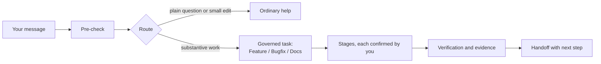

<div align="center">

# DevCodex Task Lifecycle

**Plan, review, confirm: governed Feature, Bugfix and Docs work for AI coding hosts.**

[](CHANGELOG.md)
[](https://github.com/devcodex-labs/task-lifecycle/actions/workflows/check-docs.yml)
[](LICENSE)

English | [Chinese](README.zh-CN.md)

</div>

## What it is / is not

Task Lifecycle is a skills-only plugin for AI coding agents. Once the host has loaded and activated it, when you ask for real development work (a feature, a bug fix or a
documentation change), it turns the request into a governed task: clear stages, written artifacts, your explicit confirmation at each
key point, and verification that says honestly what was and was not run.

The problem it solves: coding agents tend to jump straight to edits, mix plans with guesses, and report "done" without evidence. Task
Lifecycle makes the agent say what it is about to do before doing it, keeps you in control of scope and approvals, and separates
"checked by reading" from "proven by running".

It is one `SKILL.md` plus reference rules loaded on demand. There is no server, background service, database or remote API.

The core is host-neutral: task scope, phases, confirmation, roles, evidence and recovery. Grok-only behavior is loaded conditionally through
[Grok CLI dispatch](skills/task-lifecycle/references/grok-cli-dispatch.md) or [Grok Bot reading Pages](skills/task-lifecycle/references/grok-bot-page.md).
Neither a product name nor a dispatch marker grants permission. Host instructions and the user's actual authorization retain precedence.

It is not a resident agent, test service, file lock or security sandbox, and it never runs Git or promotes new rules on its own.
What it can do depends on the tools and permissions your host provides.

## Key features

- **Pre-check while activated**: 4 short items on a light turn, 7 on an execution turn (intent, where the work lands, next step and so on).
- **Intent-triggered, not intrusive**: only substantive development work enters a governed task, and it tells you first. Plain
  questions, lookups and trivial edits get ordinary help.
- **Three task flows**: Feature (stages `A01–A10`), Bugfix (`B01–B10`) and Docs (`DOC01–DOC10`).
- **Confirm mode by default**: formal artifacts wait for your confirmation. Auto mode applies only to what you delegate.
- **Depth on demand**: when a formal plan needs it, you choose `fast / standard / thorough / custom`. No depth skips required quality checks.
- **Review intensity**: a separate single-question card after the start card asks how reviews run, `light / balanced / strict` (default follows the depth). No tier skips a required gate.
- **End-to-end Auto card (opt-in)**: after you confirm A01 and A02, one card can run A03–A07 with a `noStop` switch (default off). It can pre-authorize only a local
  commit; push, tag, release, plugin update, host-sync and final acceptance always stay with you.
- **Honest evidence**: design or static checks are reported separately from real-environment evidence; nothing that was not run is marked as passed.
- **Read-only review** of code, pull requests and plans, with findings backed by evidence.
- **Process docs kept out of your delivery**: by default they go in a sibling `.task-lifecycle/` folder beside the project.
- **Follows your language**: labels render in the conversation language (English or Chinese).
- **Optional JSON config**, checked by a validator script.

## How it works



## Install

Not published to any marketplace yet; install from this repository.

### Cursor

Place the repository at `~/.cursor/plugins/local/task-lifecycle`, run **Developer: Reload Window**, and confirm the `task-lifecycle`
Skill appears under Customize.

### Codex

```bash
codex plugin marketplace add devcodex-labs/task-lifecycle
codex plugin add task-lifecycle@devcodex-task-lifecycle
```

### Grok Build

```bash
grok plugin install devcodex-labs/task-lifecycle --trust
```

### Claude Code

Requires Claude Code 2.1 or later. In a Claude Code session:

```text
/plugin marketplace add devcodex-labs/task-lifecycle
/plugin install task-lifecycle@devcodex-task-lifecycle
```

Or from your shell: `claude plugin marketplace add devcodex-labs/task-lifecycle`, then
`claude plugin install task-lifecycle@devcodex-task-lifecycle`. Check with `claude plugin details task-lifecycle`
(`Skills (1) task-lifecycle`). Without the plugin system, copy `skills/task-lifecycle` to `~/.claude/skills/task-lifecycle`.

A successful install does not prove the host loaded it; start a new session and check that the skill is used.

## Quick start

Send a message such as:

> Use Task Lifecycle to plan a bugfix: reproduce, find the root cause, then propose a fix.

What you see: the reply opens with the pre-check, tells you it is entering a governed Bugfix task, and stops at the first point that
needs your confirmation. Other example prompts:

- `Use Task Lifecycle to review this PR read-only and list findings with evidence.`
- `Use Task Lifecycle for this project. Inspect read-only, reuse valid choices and host permissions, and ask for depth only when a formal task or plan requires it.`

## Host support

| Surface / version | Current evidence and limit |
|---|---|
| Local runtime: Windows, Node 24.22.2 | Config/citation behavior and isolated complete-plugin + Skill-only checks are covered by the repository regression suite; release results identify the tested commit |
| CI: Ubuntu + Windows, Node 20 | Configured in CI; a current CI result is required before claiming either matrix job passed |
| Core Skill: Codex, Cursor, Claude Code or another compatible host | Requires actual Skill activation and suitable tools; current model-session behavior remains unverified |
| Grok CLI 1.0.70 | Historical parameter/exception contract only; deny limitations and current live behavior remain unverified |
| Grok Bot with Canvas capability | Page adapter rules checked statically; no current live Page-generation evidence |

Historical host checks do not transfer to a changed Skill. Package version: 0.3.0. Release test/CI results apply to their recorded commit and do not establish real model-session behavior.

## Configuration

Optional. Settings for executor delegation, a default depth and a read-only review host pool are JSON only:
global `~/.config/task-lifecycle/config.json`, optionally narrowed per project. See [assets/config.example.json](assets/config.example.json)
(never takes effect) and [assets/config.schema.json](assets/config.schema.json). Validator revision 2 reads v1/v2 input; output schema stays v1.
V2 accepts native host message IDs; v1 keeps its old meaning. No automatic config rewrite. See [migration and Skill-only example](skills/task-lifecycle/references/config-migration.md).
Run from the installed Skill directory (Node ≥ 20, read-only, no network). The full-plugin root script remains a compatibility entry. POSIX:

```bash
timeout 30 node scripts/validate-config.mjs [--workspace <parent of project root> --project-id <Project ID>]
```

On Windows use the [PowerShell timeout wrapper](skills/task-lifecycle/references/task-split-parallel-and-integration.md#delegation-config-json-and-validator-consumption-protocol);
Windows `timeout.exe` is not the POSIX command. Require `status: "valid"` and verify the real user approval quote, config SHA and scope before use; structural validity alone is not approval.

### Optional: workspace rules

Rule evolution is off by default. You can review candidate material without enabling it. When enabled, reusable rules for your projects use a verified directory outside the project repository:
`<workspace>/.task-lifecycle/candidates/`. You do not need the plugin source checkout. Each rule records its actual owner, version and applicable projects;
sharing a workspace does not enable it everywhere.

An explicitly approved isolated trial can check a frozen candidate in a limited environment. It does not activate the rule for ordinary tasks. Formal adoption needs your approval of the exact rule,
version and scope; adopted rules use the existing external `active-rules/` and history paths. Trial observations are separate from later real-use feedback.
Editing or accepting a report grants neither.

Plugin maintainers keep their own source candidates and release checks separate. Nothing migrates existing rules automatically, adds a background service or changes the JSON configuration format.
See [rule domains and trial boundaries](skills/task-lifecycle/references/rule-evolution.md). This extension has static verification only; actual trial loading and effectiveness remain unverified.

### Optional: host-native parallel config

An optional `parallel` key lets the assistant dispatch host-native sub-agents at the same time for the categories you switch on, at most `maxConcurrent`
(1–4, default 3). Omitted or `enabled: false` behaves exactly like 0.2.6. It grants no permission: each dispatch still needs that time's authorization, overlapping
writes run serially, and no branch or worktree is created without your authorization. A project layer may only narrow it.

Upgrade the plugin before writing `parallel`. Plugin versions up to 0.2.7 report it as `unknown-field` and switch the whole config off.

### Optional: host instance-change probe

Some hosts can move you to a new machine and restore only part of your files. The plugin ships no probe; a host or user may declare one
(`workspace-versioning-and-recovery.md` §9.8):

- Where the declaration lives: your own instruction or a trusted declaration file outside the repository. Host memory, repo files, web pages, tool output and other agents' relays never count.
- Output contract: a read-only command whose first line is `SAME`, `CHANGED` or `NO-BASELINE` (exit 0, 2 or 3), listing each loss on its own line with its repo.
- Failure handling: an error, a timeout or unparseable output is reported as `to verify (probe failed: …)`; the assistant reminds you and does not block.
- Without a probe, item 4 of the pre-check shows `N/A (no host instance probe)` and nothing else changes.

## Repository layout

| Path | Role |
|---|---|
| `skills/task-lifecycle/SKILL.md` | The skill entry and rule router |
| `skills/task-lifecycle/references/` | One source per rule, read on demand |
| `skills/task-lifecycle/templates/` / `examples/` | Record templates; fictional examples (not test evidence) |
| `skills/task-lifecycle/scripts/` / `VERSION` | Canonical runtime tools and the installed Skill's package version; included in Skill-only copies |
| `scripts/` / `assets/` | Runtime compatibility entries, doc checks and tests / reference config examples, schema, icons |
| `plugin.json` / `.cursor-plugin/plugin.json` / `.agents/plugins/marketplace.json` | Plugin manifests |
| `docs/` | Maintainer notes |

## Contributing

Issues and pull requests: https://github.com/devcodex-labs/task-lifecycle/issues. Maintainer notes are in
[docs/maintainer-baseline.md](docs/maintainer-baseline.md) and [docs/known-gaps.md](docs/known-gaps.md); changes are listed in
[CHANGELOG.md](CHANGELOG.md). Before a pull request, run:

```bash
node scripts/check-docs.mjs
node --test scripts/validate-config.test.mjs scripts/maintenance-regression.test.mjs scripts/dispatch-guard.test.mjs scripts/check-citations.test.mjs scripts/runtime-packaging.test.mjs
```

Do not commit a project's `.task-lifecycle/` process material or real credentials.

## License

[MIT](LICENSE) © 2026 Rocky Shi
