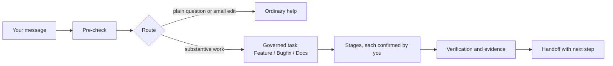

<div align="center">

# DevCodex Task Lifecycle

**Plan, review, confirm: governed Feature, Bugfix and Docs work for AI coding hosts.**

[](CHANGELOG.md)
[](https://github.com/devcodex-labs/task-lifecycle/actions/workflows/check-docs.yml)
[](LICENSE)

English | [Chinese](README.zh-CN.md)

</div>

## What it is / is not

Task Lifecycle is a skills-only plugin for AI coding agents. When you ask for real development work (a feature, a bug fix or a
documentation change), it turns the request into a governed task: clear stages, written artifacts, your explicit confirmation at each
key point, and verification that says honestly what was and was not run.

The problem it solves: coding agents tend to jump straight to edits, mix plans with guesses, and report "done" without evidence. Task
Lifecycle makes the agent say what it is about to do before doing it, keeps you in control of scope and approvals, and separates
"checked by reading" from "proven by running".

It is one `SKILL.md` plus reference rules loaded on demand. There is no server, background service, database or remote API.

It is not a resident agent, test service, file lock or security sandbox, and it never runs Git or promotes new rules on its own.
What it can do depends on the tools and permissions your host provides.

## Key features

- **Pre-check on every reply**: 4 short items on a light turn, 7 on an execution turn (intent, where the work lands, next step and so on).
- **Intent-triggered, not intrusive**: only substantive development work enters a governed task, and it tells you first. Plain
  questions, lookups and trivial edits get ordinary help.
- **Three task flows**: Feature (stages `A01–A10`), Bugfix (`B01–B10`) and Docs (`DOC01–DOC10`).
- **Confirm mode by default**: formal artifacts wait for your confirmation. Auto mode applies only to what you delegate.
- **Depth on demand**: when a formal plan needs it, you choose `fast / standard / thorough / custom`. No depth skips required quality checks.
- **Honest evidence**: design or static checks are reported separately from real-environment evidence; nothing that was not run is marked as passed.
- **Read-only review** of code, pull requests and plans, with findings backed by evidence.
- **Process docs kept out of your delivery**: by default they go in a sibling `.task-lifecycle/` folder beside the project.
- **Follows your language**: labels render in the conversation language (English or Chinese).
- **Optional JSON config**, checked by a validator script.

## How it works



## Install

Not published to any marketplace yet; install from this repository.

### Cursor

Place the repository at `~/.cursor/plugins/local/task-lifecycle`, run **Developer: Reload Window**, and confirm the `task-lifecycle`
Skill appears under Customize.

### Codex

```bash
codex plugin marketplace add devcodex-labs/task-lifecycle
codex plugin add task-lifecycle@devcodex-task-lifecycle
```

### Grok Build

```bash
grok plugin install devcodex-labs/task-lifecycle --trust
```

A successful install does not prove the host loaded it; start a new session and check that the skill is used.

## Quick start

Send a message such as:

> Use Task Lifecycle to plan a bugfix: reproduce, find the root cause, then propose a fix.

What you see: the reply opens with the pre-check, tells you it is entering a governed Bugfix task, and stops at the first point that
needs your confirmation. Other example prompts:

- `Use Task Lifecycle to review this PR read-only and list findings with evidence.`
- `Use Task Lifecycle for this project. Inspect read-only, reuse valid choices and host permissions, and ask for depth only when a formal task or plan requires it.`

## Host support

| Host | Status |
|---|---|
| Cursor | Tested |
| Codex | Tested |
| Grok Build | Tested |

What the plugin can do still depends on the tools and permissions your host provides.

## Configuration

Optional. Settings for executor delegation, a default depth and a read-only review host pool are JSON only:
global `~/.config/task-lifecycle/config.json`, optionally narrowed per project. See [assets/config.example.json](assets/config.example.json)
(never takes effect) and [assets/config.schema.json](assets/config.schema.json). Validate from the plugin root (Node ≥ 20, read-only, no network):

```bash
timeout 30 node scripts/validate-config.mjs [--workspace <parent of project root> --project-id <Project ID>]
```

Only `status: "valid"` in the output counts; otherwise these settings stay off.

## Repository layout

| Path | Role |
|---|---|
| `skills/task-lifecycle/SKILL.md` | The skill entry and rule router |
| `skills/task-lifecycle/references/` | One source per rule, read on demand |
| `skills/task-lifecycle/templates/` / `examples/` | Record templates; fictional examples (not test evidence) |
| `scripts/` / `assets/` | Validators, doc checks and tests / config example, schema, icons |
| `plugin.json` / `.cursor-plugin/plugin.json` / `.agents/plugins/marketplace.json` | Plugin manifests |
| `docs/` | Maintainer notes |

## Contributing

Issues and pull requests: https://github.com/devcodex-labs/task-lifecycle/issues. Maintainer notes are in
[docs/maintainer-baseline.md](docs/maintainer-baseline.md) and [docs/known-gaps.md](docs/known-gaps.md); changes are listed in
[CHANGELOG.md](CHANGELOG.md). Before a pull request, run:

```bash
node scripts/check-docs.mjs
node --test scripts/validate-config.test.mjs scripts/maintenance-regression.test.mjs scripts/dispatch-guard.test.mjs
```

Do not commit a project's `.task-lifecycle/` process material or real credentials.

## License

[MIT](LICENSE) © 2026 Rocky Shi
