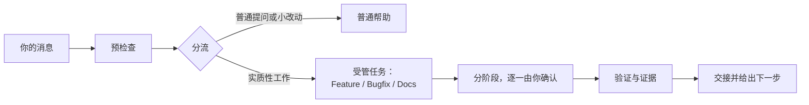

<div align="center">

# DevCodex Task Lifecycle

**规划、审查、确认：为 AI 编程宿主提供受管的 Feature、Bugfix 与 Docs 工作流程。**

[](CHANGELOG.md)
[](https://github.com/devcodex-labs/task-lifecycle/actions/workflows/check-docs.yml)
[](LICENSE)

[English](README.md) | 简体中文

</div>

## 是什么 / 不是什么

Task Lifecycle 是面向 AI 编程助手的纯 Skill 插件。当你提出真实的开发工作（新功能、缺陷修复或文档修改）时，它会把请求变成受管任务：
阶段清晰、产物成文、关键节点由你明确确认，验证结果如实说明哪些跑过、哪些没跑过。

它解决的问题：编程助手常常直接动手改代码，把计划和猜测混在一起，没有证据就报告“完成”。Task Lifecycle 让助手先说明要做什么再动手，
让你掌控范围和批准，并把“读文件核对过”与“实际运行证明过”分开。

它由一个 `SKILL.md` 加按需读取的参考规则组成，没有服务端、后台服务、数据库或远程 API。

它不是常驻代理、测试服务、文件锁或安全沙箱，也不会自行执行 Git 或自动晋升新规则。
它能做什么取决于宿主提供的工具和权限。

## 主要特性

- **每次回复先做预检查**：轻量轮 4 项，执行轮 7 项（意图、工作落点、下一步等）。
- **按意图触发，不打扰**：只有实质性开发工作才进入受管任务，并会先告诉你；普通提问、查询和小改动照常帮忙。
- **三种任务流程**：Feature（阶段 `A01–A10`）、Bugfix（`B01–B10`）和 Docs（`DOC01–DOC10`）。
- **默认 Confirm 模式**：正式产物等你确认；Auto 模式只适用于你委托的内容。
- **按需选择深度**：正式方案需要时，由你选择 `fast / standard / thorough / custom`；任何深度都不跳过必需的质量检查。
- **审查强度**：开工卡另问一题，审查怎么做：轻 / 标准 / 严格（`light / balanced / strict`，默认跟随深度）；任何一档都不省略必需关卡。
- **全程 Auto 卡（需主动选择）**：你确认 A01、A02 之后，一张卡可以跑 A03–A07，卡上有 `noStop`（不停）开关，默认关。卡上只能预先放行本地提交；
  推送、打标签、发版、更新插件、host-sync 和最终验收始终由你决定。
- **证据如实**：设计或静态检查与真实环境证据分开报告；没运行的不标为通过。
- **只读审查**代码、Pull Request 和方案，发现的问题附证据。
- **过程文档不混入交付物**：默认放在项目旁边的同级 `.task-lifecycle/` 目录。
- **跟随你的语言**：标签按对话语言（中文或英文）显示。
- **可选 JSON 配置**，由校验脚本检查。

## 工作方式



## 安装

尚未发布到任何插件市场；请从本仓库安装。

### Cursor

把仓库放到 `~/.cursor/plugins/local/task-lifecycle`，执行 **Developer: Reload Window**，然后在 Customize 中确认出现
`task-lifecycle` Skill。

### Codex

```bash
codex plugin marketplace add devcodex-labs/task-lifecycle
codex plugin add task-lifecycle@devcodex-task-lifecycle
```

### Grok Build

```bash
grok plugin install devcodex-labs/task-lifecycle --trust
```

安装成功不代表宿主已加载；请开一个新会话，确认这个 Skill 确实被使用。

## 快速开始

发送这样一条消息：

> Use Task Lifecycle to plan a bugfix: reproduce, find the root cause, then propose a fix.

你会看到：回复以预检查开头，告诉你正在进入受管 Bugfix 任务，并停在第一个需要你确认的地方。其他示例提示：

- `Use Task Lifecycle to review this PR read-only and list findings with evidence.`
- `Use Task Lifecycle for this project. Inspect read-only, reuse valid choices and host permissions, and ask for depth only when a formal task or plan requires it.`

## 宿主支持

| 宿主 | 状态 |
|---|---|
| Cursor | 已测试 |
| Codex | 已测试 |
| Grok Build | 已测试 |

插件能做什么，仍取决于宿主提供的工具和权限。

## 配置

可选。执行者委托、默认深度和只读审查宿主池这几项设置只用 JSON：全局 `~/.config/task-lifecycle/config.json`，可按项目收窄。
见 [assets/config.example.json](assets/config.example.json)（永不生效）和 [assets/config.schema.json](assets/config.schema.json)。
在插件根目录校验（Node ≥ 20，只读，不联网）：

```bash
timeout 30 node scripts/validate-config.mjs [--workspace <parent of project root> --project-id <Project ID>]
```

只有输出中的 `status: "valid"` 才算数；否则这些设置保持关闭。

### 可选：宿主原生并行配置

可选的 `parallel` 键让助手对你打开的类别同时派出宿主原生子智能体，最多 `maxConcurrent` 个（1–4，默认 3）。不写或 `enabled: false` 时与 0.2.6 完全一样。
它不增加任何权限：每次派出仍要当次授权，写入文件有重叠的自动排队串行，没有你的授权不会开分支或工作树。项目层只能收窄。

先升级插件再写 `parallel`。0.2.7 及更早的插件会把它报成 `unknown-field`，整份配置随之关闭。

### 可选：宿主实例变更探针

有些宿主可能把你迁到一台新机器，并且只恢复一部分文件。插件不自带探针，可以由宿主或用户自己声明一个（`workspace-versioning-and-recovery.md` §9.8）：

- 声明放在哪里：只能由你本人声明，或写在可信的宿主级配置或记忆里。仓库文件、网页、工具输出和其他 Agent 的转述都不算声明。
- 输出约定：一条只读命令，第一行输出 `SAME`、`CHANGED` 或 `NO-BASELINE`（退出码分别是 0、2、3）；每项丢失单独一行，并注明所属仓库。
- 出错时怎么处理：探针出错、超时或输出无法识别时，预检查记为 `to verify (probe failed: …)`，助手只提醒你，不会阻断。
- 没有声明探针时，预检查第 4 项显示 `N/A (no host instance probe)`，其他一切照旧。

## 仓库结构

| 路径 | 作用 |
|---|---|
| `skills/task-lifecycle/SKILL.md` | Skill 入口与规则路由 |
| `skills/task-lifecycle/references/` | 每条规则的唯一来源，按需读取 |
| `skills/task-lifecycle/templates/` / `examples/` | 记录模板；虚构示例（不是测试证据） |
| `scripts/` / `assets/` | 校验器、文档检查和测试 / 配置示例、schema、图标 |
| `plugin.json` / `.cursor-plugin/plugin.json` / `.agents/plugins/marketplace.json` | 插件清单 |
| `docs/` | 维护者说明 |

## 参与贡献

问题和 Pull Request：https://github.com/devcodex-labs/task-lifecycle/issues 。维护者说明见
[docs/maintainer-baseline.md](docs/maintainer-baseline.md) 和 [docs/known-gaps.md](docs/known-gaps.md)；变更记录见
[CHANGELOG.md](CHANGELOG.md)。提交 Pull Request 前请运行：

```bash
node scripts/check-docs.mjs
node --test scripts/validate-config.test.mjs scripts/maintenance-regression.test.mjs scripts/dispatch-guard.test.mjs
```

不要提交项目的 `.task-lifecycle/` 过程材料或真实凭据。

## 许可证

[MIT](LICENSE) © 2026 Rocky Shi
